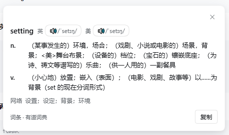

# 智能划词翻译 · smart-selection-translate

> 在 DeepSeek Harness 的对话和侧栏文件预览里，选中一段英文就地翻译：单词出词典条目，句子走机器翻译。

[](https://github.com/deepseek-ai/deepseek-harness)
[](LICENSE)

## 特性

- **划词即译**：选中文字、松开鼠标即触发；双击单词等于选中它，同样触发。
- **单词查词典**：英/美音标、按词性分组的释义、网络释义，可播放真人发音。
- **句子走翻译**：Bing、Google（匿名免账号）、DeepSeek Flash（走当前会话记账）。
- **两个词典源**：有道、必应，可切换，也可设为「自动」按顺序回退。
- **跟随宿主**：卡片与设置页只用 `--dsw-alias-*` 主题令牌，亮/暗色自动切换。
- **不打断阅读**：卡片贴着选区弹出，`Esc` 或点击别处关闭；同一段文字 800ms 内不重复请求。

## 截图

**单词** — 英/美音标与发音按钮、按词性分组的释义、网络释义。



**句子** — 整句译文，底部可朗读、可复制。


## 安装

插件以 DeepSeek Harness 的 *bundle* 形式分发，装进某个 profile 后对所有会话生效，重启仍在。

```bash
git clone https://github.com/Sunshine334419520/smart-selection-translate.git
```

然后在 Harness 里用 Plugin Manager 安装该目录（`install_bundle` 的 target 指向仓库根目录）。安装完成后刷新页面。

### 依赖

本插件自带翻译引擎行，安装时会在 profile 里插入：

```yaml
- id: translator
  name: '@deepseek-ai/dsh-experimental-translator'
```

该包随 dsh 一起分发，不需要单独安装。**若之后又启用了官方「思考翻译」bundle，两边会争同一个 row id `translator`**，先移除本插件或删掉上面这行再启用。

## 使用

1. 在对话正文、或右侧栏打开的文件预览里，拖选一段英文。
2. 单词（或两三词的短语）弹出词典条目；整句弹出译文。
3. 卡片上可按 🔊 听发音，按「复制」拷贝内容。
4. 按 `Esc` 或点击空白处关闭。

> PDF 与 Office 预览由 pdf.js 画在 canvas 上，父文档取不到文字层，划词不生效；HTML 预览若在 sandboxed iframe 内同样取不到。

## 设置

设置 → 智能划词翻译。

| 项 | 默认 | 说明 |
|---|---|---|
| 启用 | 开 | 关掉后选中文字不再触发 |
| 触发方式 | 选中即翻译 | 或「选中后先显示按钮」，不自动发请求 |
| 单词查词典 | 开 | 关掉则单词也走机器翻译 |
| 词典源 | 有道词典 | 有道 / 必应 / 自动（先有道，查不到再必应） |
| 机器翻译引擎 | Bing | 只作用于句子和段落；匿名引擎免账号，DeepSeek Flash 走当前会话记账 |
| 译文语言 | 简体中文 | 简中、繁中、英、日、韩 |
| 只翻英文 | 开 | 选区里英文不比中日韩文字多时跳过 |

设置保存在浏览器 `localStorage`（键 `dsh.smart-selection-translate.v1`），不随会话变化。

## 工作原理

### 两条通道

| 选中内容 | 通道 | 来源 |
|---|---|---|
| 1–3 个英文词 | `GET /api/smart-selection-translate/dict` | 有道 `jsonapi` 或必应词典页 |
| 句子 / 段落 | `POST /api/smart-selection-translate/translate` | `ctx.translator` |
| 发音 | `GET /api/smart-selection-translate/audio` | 有道 `dictvoice`，失败回落 `speechSynthesis` |

词典查询失败或未收录时，客户端自动回落到机器翻译，不会出现空卡片。

### 为什么由 Host 发请求

匿名翻译端点（Bing/Google）不给浏览器跨域，词典页也带反爬指纹；由 Host 统一出网既绕开 CORS，也不把任何凭据放进页面。

路由注册优先走 `ctx.connection.fetch.register()`（挂在 `/api` 下，由载体做 Origin 围栏与会话认证）；拿不到 `connection` 时退回 `ctx.webServer.register({ kind: 'exact' })` 的裸 node 处理器。

### 翻译服务的解析

`translator` 由本 bundle 的 patch 行插入在 profile 根作用域，但插件的 `apply` 可能早于它注册完成，所以每次请求都重新解析：

1. `ctx.get('translator')`
2. 退回到任意活跃 Agent 的 `agent.ctx.get('translator')`（会话作用域）

### 选中判定

监听 `mouseup`（拖选）与 `keyup`（Shift 选区），去抖后读取 `window.getSelection()`；`dblclick` 只在选区为空时用 `caretRangeFromPoint` 兜底取词。输入框、`contenteditable`、以及插件自己的卡片内不触发。

## 界面规范

| 元素 | 取值 |
|---|---|
| 设置行 | `padding:16px 0`、`.5px solid var(--dsw-alias-border-l2)` 分隔线、标题 14/20、说明 12/18、`gap:24`（照宿主 `DeveloperToolsRow`） |
| 卡片 | `bg-layer-1` 底 + 双层阴影 + 12 圆角 + `.5px` 描边 |
| 开关 | 32×20、圆角 999；开启深色轨道 + 白滑块，关闭浅灰轨道 + 白滑块 |
| 文本 | 全部走 `--dsw-alias-label-primary` / `-secondary`，不写死颜色 |

关闭态轨道用 `color-mix(in srgb, var(--dsw-alias-label-primary) 14%, transparent)` 而不是 `bg-layer-2`——后者在亮色主题下就是白色，会和滑块糊在一起。

## 目录结构

```
smart-selection-translate/
├── index.js              # Host 半：4 条路由、词典解析、翻译转发
├── client.js             # Client 半：选区监听、卡片、设置页
├── cordis.patch.yml      # bundle 的 Loader 补丁
├── package.json          # dsh.bundle / dsh.client 声明
├── locale/{zh,en}.json   # 插件页标题与描述
├── icon.svg
└── test/host.test.mjs    # Host 半单测
```

## 开发

```bash
node --test test/host.test.mjs   # 27 项
```

覆盖：入参校验、上限截断、未知引擎回落、付费路由强制 `sessionId`、错误码透传、取消信号、路由注销，以及有道 / 必应两种词条 payload 的归一化。

## 已知限制

- PDF / Office / 部分 HTML 预览取不到文字层，划词不生效。
- 匿名端点（Bing、有道、必应词典）都是非官方接口，可能限流或改版；大陆网络下 Google 常常不可达。
- 有道朗读接口对长句会返回 500，句子的朗读走浏览器 `speechSynthesis`，音色取决于系统。
- 付费引擎（DeepSeek Flash）需要已配置的账号或 API Key，且需要当前打开一个会话用于记账。

## 许可证

MIT
